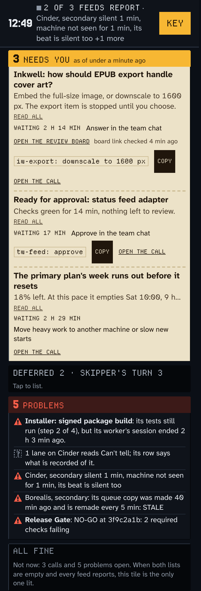

# Weatherdeck

Weatherdeck is a status board for machines and the work running on them (a TV or phone page fed by small pushers), not a weather app and not a monitoring or alerting system.


**What you see.** Every picture here is the demo (`weatherdeck run --demo`, with `#theme=ship-deck` on the page address). Its sources are invented and nothing in it is real.

- **Waiting on you.** The amber plate counts the calls that need a person and says how long each has waited.
- **Honest progress.** Progress shows as a percent range where the source gives one (for example 38-42%). A lane the board cannot read is counted as "can't tell" (the "+7 more" line says 1), not shown as fine.
- **A quiet source is named.** The lamp by the clock counts live sources. When one stops reporting it reads "2/3 live", and that machine's ship is drawn in fog and labelled silent.
- **One board for TV and phone.** The same page is the open sea on a wide screen and one column on a phone.


In the clip, Cinder (one of the invented sources) stops reporting. [Still frame](docs/img/tour-still.png).



The phone page from a few minutes into the demo, cropped after the ALL FINE tile: the calls, then the problems, then that tile, which is lit only when no call or problem is open and every feed reports.

It is an at-a-glance board for work reported by many sources, meant to be left on a TV or a
phone: what is waiting on you, what is moving and how far along it honestly is, what got done, what
is next, and whether you can trust what you are looking at.

- **Any tool can leave a card.** One small JSON file in a drop directory becomes a status tile; the board only reads it ([docs/ADDINS.md](docs/ADDINS.md)).
- **Any tool can feed it.** A source is anything that can send one JSON document over HTTP. Sources are discovered, never configured; machines and items appear on their own.
- **Checkable.** Every push a host receives is one line in its received log (`weatherdeck received --diff`): what each source sent and what changed on the board.
- **Honest about gaps.** A source that stops reporting stays on screen, marked silent and fogged. The board never shows stale data as fresh, and says so when a source is missing. It claims no value for itself or any tool until a number is measured ([docs/honesty.md](docs/honesty.md)).
- **Read-only, local, tiny.** Python standard library only, one SQLite file, one plain HTML/JS/CSS page. No build step, no CDN, no telemetry, no root.
- **Runs anywhere.** The same command natively on Windows, macOS and Linux, no admin needed. Run several hosts at once; every page says which host serves it.
- **Deterministic.** No model or LLM call anywhere; the only outbound traffic is an adapter pushing to a host you name.

**What this is not.** It is not a monitoring or alerting system: it never pages anyone, and it shows only what sources push to
it. It is not a hosted service: you run it yourself, on machines you choose. And it is pre-1.0 hobby software, open-sourced
because it solved a problem the author had: details may change, and support is best effort.

## Five-minute quickstart

You need Python 3.9 to 3.14 (an older one stops at startup with a one-line message; the Microsoft Store one is fine for trying it; to run it at logon or run the
beat, see [docs/runbook-windows.md](docs/runbook-windows.md)). Nothing to install: run it from a source checkout or the release zip. Get the code by cloning this repository
(`git clone` it, then `cd` into the folder), or by unzipping the zip that `scripts/build-package` builds from a clone. `pip install` is not supported yet and stops with a
message saying so. Below, `weatherdeck` means `python3 bin/weatherdeck` on macOS/Linux and `bin\weatherdeck.cmd` on Windows (cmd or PowerShell).

1. **See it with synthetic data.**

   ```
   weatherdeck run --demo
   ```

   Open <http://127.0.0.1:8787/>. Three invented sources report; one stops reporting after about
   two and a half minutes, shows late from about 2:40 and silent about three minutes after start, so you can see the offline state. Ctrl-C stops it. (`--port N` to change the port.)

2. **Run it for real.**

   ```
   weatherdeck on        # background; prints the URLs
   weatherdeck status
   weatherdeck off
   ```

   The data lives in your per-user data directory (`--data DIR` or `$WEATHERDECK_DATA` to choose another).
   On Windows, `weatherdeck startup install` also starts it at every logon, with no admin rights.

3. **Send it something.** Any tool, one POST (from the same machine, no setup needed):

   ```
   curl -X POST http://127.0.0.1:8787/api/ingest -H 'Content-Type: application/json' -d '{
     "schema": "lookout.feed", "schema_version": "1.0",
     "source": { "id": "my-laptop" },
     "items": [{ "id": "build", "title": "Nightly build", "state": "running" }]
   }'
   ```

   The schema id reads `lookout.feed` on purpose: it is the wire name every adapter already speaks, kept unchanged
   when the product was renamed (see [docs/feed-spec.md](docs/feed-spec.md), "Schema ids").

   To feed it continuously, run the example adapter, which turns a hand-edited list plus this
   machine's vitals into a feed and pushes it to every host in a list:

   ```
   cp examples/adapter/work.example.json work.json
   cp examples/adapter/sinks.example.txt sinks.txt     # edit the hosts
   python3 examples/adapter/push_example.py --work work.json --sinks sinks.txt
   ```

   To feed it from your own tool, see [docs/adapters.md](docs/adapters.md), "Write a pusher for your tool".

4. **Let other devices see it.** Add addresses to `hosts.bind` in your config file (a LAN address, a
   VPN range, or both), create a token per source
   (`weatherdeck token new my-laptop`), and open the page from your phone. Once any token
   exists, pushes need `Authorization: Bearer <token>`. For a TV, open the page full-screen on any
   machine that can reach the host, or in kiosk mode on the host itself.

   The config file is `<data>/config.json`, in the data directory from step 2 (`weatherdeck status` prints that
   directory; `--config FILE` or `$WEATHERDECK_CONFIG` names another file). It does not exist until you create it. A minimal one:

   ```
   { "hosts": { "bind": ["localhost", "auto:192.168.1.0/24"] } }
   ```

   Restart the host after editing it (`weatherdeck restart`). Every key is in [docs/hosting.md](docs/hosting.md).

5. **Remove it.** Stop the host with `weatherdeck off`, then delete the folder you unpacked or cloned and the data directory
   (where `weatherdeck status` says it is). On Windows, run `weatherdeck startup remove` first if you ran `startup install`.
   Nothing else is installed: no service, no registry entry, no files elsewhere.

## Support

| | Windows 11 | macOS (Apple Silicon) | Linux (Ubuntu, WSL2) |
| --- | --- | --- | --- |
| Host (`weatherdeck run`, `on`, `ingest`) | supported | supported | supported |
| Python | 3.9 to 3.14 (3.8 is not supported) | 3.9 to 3.14 (3.8 is not supported) | 3.9 to 3.14 (3.8 is not supported) |
| Test suite on GitHub's hosted runners (2026-10-16; 453 tests, `.github/workflows/test.yml`, run by hand) | passes on Python 3.9 to 3.14. The first run the same morning failed 13 tests on every Windows leg (nine started Node with a command line Windows refuses as too long; the rest were tests assuming a Linux machine, a code-page decode, and a scratch clone Windows would not delete); they were fixed and the second run passed all 18 jobs | passes on Python 3.9 to 3.14 | passes on Python 3.9 to 3.14 |
| Page: Chrome, Edge | supported | supported | supported |
| Page: Safari (macOS), iPhone | headless WebKit (layout, overflow, console errors); the dashboard depth scene was checked and signed off on Safari, iPhone and a 4K TV on 2026-10-10 by the maintainer, and nothing else on those devices has been ([docs/device-checklist.md](docs/device-checklist.md)) | same | same |
| Page: Firefox | expected to work, not checked each release | | |
| Since you last looked (browser storage) | per browser; a browser that blocks site data shows no since plate | same | same |
| Feed schema read | 1.0 to 1.11 | 1.0 to 1.11 | 1.0 to 1.11 |
| One ship per machine (0.4.0) | TV: up to six ships, then a convoy; phone: the convoy strip scrolls inside itself | same | same |
| The open sea (0.4.1) | TV (ship deck): with nothing waiting, one banner line and the sea across the whole upper area; checked at 1920 x 1080 and 3840 x 2160 | same | same |
| Versions per machine (0.5.0) | reporter rows, the watch strip, the trust line and the phone's SOFTWARE section say each source's adapter, or "version unknown"; only a gap that changes meaning is flagged | same | same |
| Last seen and the replay key (0.4.1) | per browser tab (session storage); a tab that blocks it starts with "not yet on this screen" | same | same |
| Slowed on purpose (0.7.0) | words only (trust line, Crow's nest); nothing to check beyond reading them | same | same |

The hosted runs are the first runs of the test suite on macOS and Windows images; before them it had been run on Linux and WSL2 and on one Windows 11 PC and one Mac by the maintainer. The hosted Windows image is Windows Server, not Windows 11, and the suite runs the page-script tests with Node; the maintainer's own Windows 11 PC runs the host day to day, which the hosted run does not cover.

What each release was actually run on is in [CHANGELOG.md](CHANGELOG.md), with the checks only a person can make
(a real Safari, iPhone and TV; only the dashboard depth scene has been signed off so far, see
[docs/device-checklist.md](docs/device-checklist.md)) listed as such. Tests: `python3 -m unittest discover -s tests` (see CONTRIBUTING.md).

## Documents

- [docs/honesty.md](docs/honesty.md): the honesty contract on one page: what the board never does (green when silent, zero for unknown, a made-up event), where every number, creature and light comes from in the feed, the machine-alert debounce (two feeds to raise, two to clear, one keepalive of latency), and why no value number is shown until it is measured.
- [docs/ledger-spec.md](docs/ledger-spec.md): the tool value ledger: one append-only file per tool, unknown written as unknown with its reason, the honest verbs (surfaced, refused, placed, landed, not dispatched), and the reading rule that turns fourteen days of lines into KEEP, QUIET, CUT-CANDIDATE or UNMEASURED. No value number is shown until it is measured.
- [docs/feed-spec.md](docs/feed-spec.md): the feed schema (1.11), how sources merge, the five lane classes, machine rest and strain, lane state (one word and one sentence per lane), goals (the goal each lane serves, with a count under it), allowance chips, black holes (no agent at the work, outside waits, queues, coming up, the shipping gap, freshness, burn rate), the library (one honest age and word per mirrored folder), the view at a glance (since you last looked, grouping by project), and what silence looks like.
- [CHANGELOG.md](CHANGELOG.md): what changed in each release, and what it was checked on; [docs/device-checklist.md](docs/device-checklist.md): what only a person can check on a real Mac, iPhone and TV.
- [docs/ADDINS.md](docs/ADDINS.md): the card contract: one small JSON file per tool in a drop directory, shown as a tile with a stale mark. Nothing is run or imported.
- [docs/adapters.md](docs/adapters.md): write a pusher for your tool: what to send, the sinks file, the honesty rules for adapters, and how to test one by recording and replaying the files it reads.
- [docs/hosting.md](docs/hosting.md): the `weatherdeck` command, binding and profiles, every config key, transports, pushing to several hosts.
- [docs/runbook-windows.md](docs/runbook-windows.md) and [docs/runbook-macos.md](docs/runbook-macos.md): half a page each to run a host.
- [docs/runbook-feed-gap.md](docs/runbook-feed-gap.md): a silent feed versus a machine that is down: the read-only checks in order (uptime, lingering, timers, the journal or cron log, the beat's age) for Linux, macOS and Windows, what each answer means, and whether `KillMode=process` matters for a pusher package.
- [docs/beat.md](docs/beat.md): the machine beat (`bin/weatherdeck-beat`): memory pressure, swap rate, run queue and disk per machine, its cost, and how it reaches the board.
- In the source repository: `scripts/build-package` builds the distributable zip (the product only; every entry carries the commit time of HEAD, or `SOURCE_DATE_EPOCH` when set, so the same commit built with the same Python and zlib on the same OS gives byte-identical zips and `sha256sum` is a real comparison there; across machines or OSes compare per-file content instead, in a scratch directory: `unzip -q <zip> -d x && (cd x && find . -type f | LC_ALL=C sort | xargs shasum -a 256 | shasum -a 256)`, which works on Linux and macOS; file modes still differ on a Windows checkout; a build from a tree that is not a git checkout stamps 1980-01-01, so compare only builds of the same commit or of the same kind of tree), `scripts/self-audit` scans for secrets and names before a release, `scripts/release-scan` runs it and also scans the whole git history for names, e-mail addresses, home paths and tokens (see [CONTRIBUTING.md](CONTRIBUTING.md)). Packages that bundle an adapter for a specific tool are built from that adapter's own repository, not here.
- `examples/`: the synthetic demo feeds, a tiny generic adapter and an example host config (`examples/host/`).

## Try it without installing

Open the static demo: a folder of plain files that shows the board with a recorded feed of invented sources, no server and no
Python needed to look at it. It is built in the source repository, not from this package (which does not carry the build scripts): there,
`python3 scripts/build-static-demo` writes `dist/static-demo/`; open `dist/static-demo/index.html` in a browser, or put that folder on any static host. A yellow bar, **DEMO: recorded synthetic feed**,
stays on the screen and says nothing is live. The page replays three recorded frames in order, a slow step every 25 seconds, so
the calls, lanes and weather change as they did in the recording (with reduced motion it holds one frame and offers a button for
the next). To record the frames again, in the source repository, `python3 scripts/record-demo-feed`.

## What is on the screen

On a TV, a desk screen or a laptop (any window 700 CSS px or wider) the front door is the open sea (`#/sea`, or no route): the
fleet on the water at full screen, one ship per machine with its name plate, the headline card for the calls on the left and the
log along the bottom, on a 640 x 360 art-pixel stage. Each ship plate carries a quiet badge: how many asks wait on you from
that machine, and how many of its lanes are off course or alerting. A ship opens its plan, a place opens its list. The
**Lists** door beside the `?` (and in a ship's plan bar) opens the page board (`#/board`,
docs/theme-spec.md section 24): a header with the way back to the sea and the key, a three-state strip (needs you, needs
attention, all fine), the lanes grouped under the goal they serve, else by project (a state word and icon, the job, one
sentence, the worker's own notes behind a tap) and the sea with a caption for every picture. On a phone the page board is
`#/sea` itself. The `tv` view never shows the page board: there the sea is the whole display. The list below describes the
stage's parts (one column on a phone with the `tv` view).

1. **Waiting on you** (the one amber plate): decisions, approvals, capacity and machine problems, with where to act. A critical takes over the bar instead.
2. **Trust:** a lamp by the clock says how many sources are live and how old the newest report is; a silent source is named there, its machine reads SILENT and its work keeps its state with LAST KNOWN beside it.
3. **Machines:** a pip and a word each (OK, STRUGGLING judged against the machine's own norm, a low disk, ALERT, SILENT, LOST, or ASLEEP for a machine you list in `display.may_sleep` that went quiet during quiet hours), with vitals on the default board and the phone. A machine its owner declared RESERVED, under MAINTENANCE or DRAINING is shown calmly, with its reason and until when, and its silence is not an alarm.
4. **The log:** off course first: work that needs action (failed, blocked, a call) and work running long, nothing else. Then the rest, calmer: under way, waiting (on a gate, a PR, a person, capacity or quiet hours, and until when, counted apart), no word, landed. Each row has a project chip, a plain title cut only at a whole word, one of six row words (Waiting on you, Stuck, Can't tell, Working, Waiting on someone else, Finished) and one sentence (never a raw status line or a task id; the full text is inside the opened row; see [docs/theme-spec.md](docs/theme-spec.md) section 9.5) and an honest percent *range*, or its phase ("2 of 4") when the source knows the phase and not a percent; rows that do not fit fold into one "+N more" row. Its last row carries one chip per allowance account: provider, account, window, percent left and reset time, in a fixed order.
5. On the phone, below: waiting items, work under way, waiting, landed in the last 24 hours (or since your day start), up next, releases, allowance, machine vitals, sources and the last 12 hours.

6. **Click in.** Every plate is a door to its place, and every row in a place opens in full: the calls (each with the exact line to say in chat and a Copy button; the board never sends anything), the lanes with their steps and history, what is next, what landed, the machines with their stations and reporters, and the log of every push the host received. Each level is a URL (`#/ship/<machine>/deck/bridge`), so Back, a shared link and a pinned TV work; a TV left on a deck or on the lists returns to the open sea after a minute. See [docs/theme-spec.md](docs/theme-spec.md) section 16.

Quiet hours with nothing waiting show a dim resting screen on the TV; a lost host shows a plate that
counts down to the next try.

**Themes.** The core is generic; each look is a folder under `web/themes/` (`theme.name` in the
config). `default` is plain slate with system faces. `ship-deck` draws the fleet as a ship at sea in
hi-bit pixel art (machines are deck sections, work is the crew), with self-hosted OFL fonts. Each sailor stands at the
station for its lane's stage, and a few creatures carry one piece of news each: a longboat for a landing, dolphins
escorting the first one in ten minutes, gulls that leave a machine whose reporters go late, a whale for a release, slack
sails for work gone quiet, and a lighthouse for the board's own host. Each is written to the Logbook. Opt-in sound
(off by default) rings bells for a new call. See [docs/theme-spec.md](docs/theme-spec.md) sections 16 and 17;
`weatherdeck run --demo --scenario sea-life` plays every one in about three minutes.

Preview any state without touching data: add `#controls=1` to the page URL and use the buttons
(late, stale, lost, host down, empty, loading, night, anchor, sky, motion, theme). `#night=1` forces
the night palette, `#theme=ship-deck` previews a theme.

## Privacy and safety

- Binds only the addresses you list; `0.0.0.0` and `::` are refused. Default: localhost only.
- No tokens: ingest from the local machine only. With tokens: per-source, and a token cannot speak for another source.
- **View profiles:** `full` at `/`, a `tv` view at `/tv/` for a screen the household can see (task titles, repo names and pull-request links, no free text about what a worker is doing), and a redacted `public` view at `/public/` (counts, group and machine names, percent only). Each has its own optional read token, and each listen address chooses which profiles it serves, so a TV on the LAN can be given the `tv` view only. `weatherdeck privacy on` turns the `tv` view into counts only until `weatherdeck privacy off`. Redaction happens on the host, never only in the browser.
- Feed text is untrusted: the page sets it with `textContent`, under a strict content security policy.

## Layout

```
bin/weatherdeck(.cmd)    the command (launchers for src/)
src/weatherdeck/         server, ingest, merge, history store, demo player
web/                 the page: index.html, theme.js, frontdoor.js, model.js, board.js, decks.js, page.js, sightings.js, livery.js, weather.js, world.js, app.js, style.css; themes/
examples/            demo feeds, a generic adapter, an example host config
docs/                spec and hosting guide
scripts/            self-audit, release-scan, merged-check, build-package, build-static-demo, record-demo-feed (source repo only)
```

## Licence, contributing and support

MIT licensed, see [LICENSE](LICENSE). The name is "Weatherdeck" (one word); the wire schema ids keep the earlier name
([docs/feed-spec.md](docs/feed-spec.md), "Schema ids").

- Contributing: [CONTRIBUTING.md](CONTRIBUTING.md). Open an issue first for anything beyond a small fix.
- Questions and bugs: [SUPPORT.md](SUPPORT.md), through GitHub issues.
- Security reports: [SECURITY.md](SECURITY.md), through GitHub's private vulnerability reporting, never a public issue.
- Conduct: [CODE_OF_CONDUCT.md](CODE_OF_CONDUCT.md).
